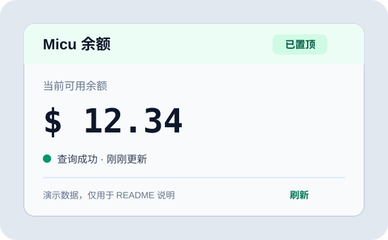

# MicuQuotaWidget

> 一个简洁的 Windows WPF 桌面余额小组件：展示 Micu 余额、每 10 秒刷新，并可切换始终置顶。<br>
> A compact Windows WPF desktop widget for Micu balance: refreshes every 10 seconds and supports always-on-top.



<!-- VERSION: 0.1.0 -->

## 中文

### 功能

- 约 326 × 202px 的轻量桌面卡片，仅展示余额、状态和最近刷新时间。
- 首次打开后在“设置”中选择 Micu API 或 Micu Subscription，并输入专用于余额查询的 API Key。
- 默认每 10 秒刷新一次；刷新请求不会重叠，失败时保留最近一次成功余额。
- “置顶”按钮可随时开启或关闭 `Topmost`；`Ctrl+R` 立即刷新，`Ctrl+T` 切换置顶。
- API Key 只写入 Windows Credential Manager 的当前用户凭据，不进入项目文件、日志或截图。

### 重要说明

- 余额路径参考公开的 MicuCodeLine / MicuSubCodeLine 源码，不依赖或解析其 CLI 输出。接口并非已验证的公开稳定契约；升级前请阅读 [米醋余额适配器](docs/米醋余额适配器.md)。
- 该工具仅发起只读余额查询，不发送模型调用请求。
- 截图中的余额是演示数据，不代表真实账户或额度。

### 开发

```powershell
dotnet restore .\MicuQuotaWidget.sln
dotnet build .\MicuQuotaWidget.sln -c Release
powershell.exe -NoLogo -NoProfile -ExecutionPolicy Bypass -File .\scripts\Invoke-QualityGate.ps1
```

详细开发、测试与发布要求见 [AGENTS.md](AGENTS.md) 及 [docs](docs)。

## English

### Features

- A compact 326 × 202px desktop card showing only balance, request state, and last refresh time.
- On first launch, use **Settings** to choose Micu API or Micu Subscription and enter an API key dedicated to balance reads.
- Refreshes every 10 seconds by default. Requests never overlap, and the last successful value remains visible after a failure.
- Toggle `Topmost` at any time. `Ctrl+R` refreshes immediately; `Ctrl+T` toggles always-on-top.
- The API key is stored only in the current user's Windows Credential Manager entry, never in project files, logs, or screenshots.

### Important notes

- Query paths are derived from the public MicuCodeLine / MicuSubCodeLine source code. They are not a verified, versioned public API contract; read the [Micu balance adapter notes](docs/米醋余额适配器.md) before upgrading.
- The widget issues read-only balance requests and never sends model-inference requests.
- The screenshot uses demo data and does not represent a real account or quota.

### Build

```powershell
dotnet restore .\MicuQuotaWidget.sln
dotnet build .\MicuQuotaWidget.sln -c Release
powershell.exe -NoLogo -NoProfile -ExecutionPolicy Bypass -File .\scripts\Invoke-QualityGate.ps1
```

See [AGENTS.md](AGENTS.md) and [docs](docs) for the required development, testing, and release workflow.
